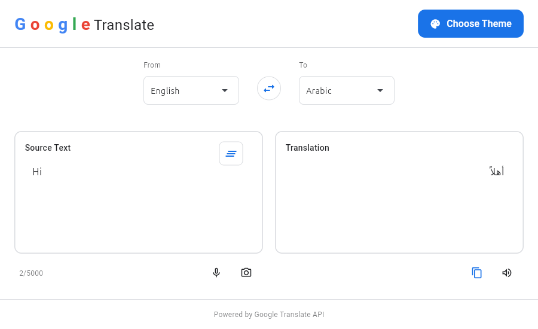
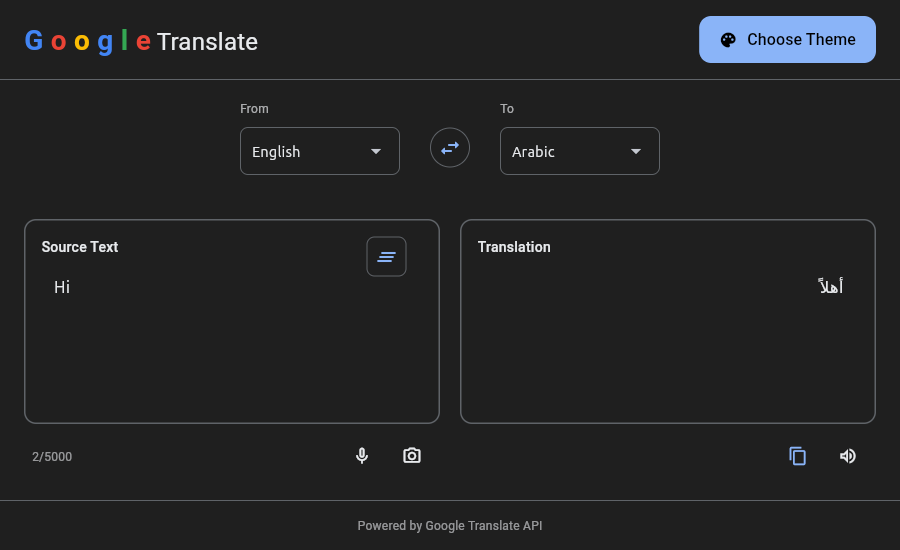

# GTrans Desktop

<!--  -->

A sophisticated desktop translation companion that brings the power of Google Translate to your fingertips with multiple input methods and a beautiful, intuitive interface.

---

| Theme | Screenshot |
|-------|------------|
| **Light Mode** |  |
| **Dark Mode** |  |

---

## 💡 Why "GTrans"?

The name **GTrans** is a deliberate, compact alias for **Google Translate** — the tool this app is built around. It reads naturally (you can say it in one syllable-plus), fits cleanly into a window title, a taskbar tooltip, and an installer filename, and it signals exactly what the app does without pretending to be an official Google product.

The "G" carries the lineage, the "Trans" carries the function.

---

## 🎯 Why I Built This

Google Translate is excellent. Its **web interface**, however, has one nagging problem: every phrase you translate becomes a browser history entry. If you translate something private — a message, a résumé line, a medical note — that text now lives in your browser's history, autocomplete suggestions, and any synced profile you're signed into. Even in an incognito window, you're still dealing with a browser tab, an account prompt, a cookie banner, and a web page that reloads when your Wi-Fi hiccups.

**GTrans is the translation experience without the browser baggage.** It's a small native desktop app that talks directly to Google's translation endpoint, so what you type stays between you and the service — no history, no tabs, no clutter, no sign-in.

**Bottom line:** GTrans is for people who use Google Translate several times a day and don't want a browser tab, a history entry, or an account prompt every time. It's the same service, with the web layer removed.

---

## 🚀 Quick Start

### **Manual Setup & Installation**
```bash
# Clone the repository
git clone https://github.com/osamalzabidi/gtrans.git
cd gtrans

# Install dependencies
pip install flet[all] googletrans

# Run the application
python3 main.py
```

<!--
### **Latest Version:** `v1.0.0`
**Release Date:** November 27, 2025
**Python:** 3.12+
**Platform:** Windows, macOS, Linux
-->

---

## 🌟 Features

### **Core Translation**
- ✅ **Text Translation** – Real-time text translation
- ✅ **Multiple Languages** – 100+ languages
- ✅ **Auto Language Detection**
- ✅ **Language Swap**
- ✅ **Copy Translation**

### **Translation Methods**
- ✅ **Text Translation**

### **UI/UX**
- ✅ **Modern Google-style UI**
- ✅ **Light/Dark Theme**
- ✅ **Responsive Design**

---

## 📋 Changelog

### **v1.0.0 (Current)**
- ✅ Theme support
- ✅ 100+ language support
- ✅ All core translation methods

---

## 📋 TODO / Upcoming Features

### **High Priority**
- [x] Smarter auto-detect language
- [x] Settings Page
- [ ] Pronunciation display

### **Settings Page Features**
- [x] Proxy configuration
- [x] Startup window size
- [x] Service URLs
- [x] User agent customization
- [x] Timeout settings
- [x] Default languages
- [ ] HTTP/2 toggle

### **Helper Methods**
- [x] Text cleaning utilities (`_`, and other untranslatable chars)
- [ ] Translation history

### **Additional Features**
- [ ] About page
- [ ] Offline Mode
- [ ] Keyboard shortcuts
- [ ] Additional translation engines
- [ ] Translation memory
- [ ] Document Translation (PDF, DOC, DOCX, TXT)
- [ ] Voice Translation (Speech-to-text)
- [ ] Camera Translation (real-time OCR)
- [ ] Conversation Mode (bilingual live translation)

---

## 🤝 Contributing
Contributions are welcome!  
Please check the contribution guide.

---

## 📄 License
This project is licensed under the **GPL-3.0 License**.

---

## 🙏 Acknowledgments
- `flet` UI framework
- `googletrans` library
- All contributors & testers

---

**Note:** This desktop application is for personal use. Please respect Google’s Terms of Service when using their translation services.
